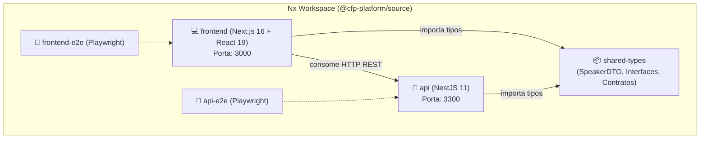

# 🎤 CFP Platform (Call for Papers)

<div align="center">


<p align="center">
  <strong>Plataforma moderna para submissão, gerenciamento e visualização de propostas de palestras técnicas (Call for Papers).</strong>
</p>

[Visão Geral](#-visão-geral) •
[Funcionalidades](#-funcionalidades) •
[Arquitetura](#-arquitetura) •
[Como Executar](#-como-executar) •
[Endpoints da API](#-endpoints-da-api) •
[Testes](#-testes-e-qualidade) •
[Governança OpenSpec](#-governança-com-openspec)

</div>

---

## 📌 Visão Geral

A **CFP Platform** é uma solução completa desenvolvida no formato de **Monorepo com [Nx](https://nx.dev)** para otimizar o fluxo de envio e avaliação de palestras para conferências e eventos tecnológicos.

O projeto foi concebido seguindo as melhores práticas de engenharia de software contemporânea:
- **Segurança de tipos de ponta a ponta (End-to-End Type Safety)** através de biblioteca compartilhada (`shared-types`).
- **Validação estrita de contratos** tanto na camada de transporte HTTP (NestJS com `class-validator`) quanto no cliente (Next.js).
- **Acessibilidade e Usabilidade (WAI-ARIA)** com design limpo, estados reativos, feedback assíncrono e suporte completo a leitores de tela.
- **Governança orientada a especificações** com o ecossistema **OpenSpec**.

---

## ✨ Funcionalidades

- **📝 Submissão Intuitiva de Palestras**:
  - Formulário acessível com validação em tempo real.
  - Bloqueio de submissão duplicada ou prematura durante requisições (`aria-busy`).
  - Coleta detalhada: Nome do palestrante, e-mail, título da palestra e reconhecimento como Google Developer Expert (GDE).
- **📊 Dashboard de Propostas**:
  - Visualização de todas as palestras submetidas com listagem moderna em cards.
  - Indicadores e métricas rápidas (total de palestras e contagem de palestrantes GDE).
  - Badge exclusivo para Google Developer Experts.
  - Tratamento elegante de estado vazio (*empty state*) e alertas de erro na comunicação com a API.
- **🔄 Navegação Integrada**:
  - Roteamento nativo e sem recarregamento entre o formulário (`/`) e o dashboard (`/dashboard`).

---

## 🏗 Arquitetura

O monorepo é estruturado para garantir máxima modularidade, reuso e independência de compilação:



### Divisão de Projetos

| Projeto | Tecnologia | Responsabilidade |
| :--- | :--- | :--- |
| **`frontend`** | Next.js 16 (App Router), React 19, CSS Modules | Interface de usuário (Formulário CFP e Dashboard de palestras) |
| **`api`** | NestJS 11, Express, Class-Validator | API RESTful com endpoints para criação e consulta de palestras |
| **`shared-types`**| TypeScript Library | Contratos de dados compartilhados (`SpeakerDTO`, `CreateSpeakerDto`) |
| **`api-e2e`** | Playwright / Node | Testes de integração e ponta a ponta da API |
| **`frontend-e2e`**| Playwright | Testes automatizados de jornada do usuário no navegador |

---

## 🚀 Como Executar

### Pré-requisitos
- **Node.js**: v20.x ou superior recomendado
- **npm**: v10.x ou superior

### 1. Clonar o Repositório
```bash
git clone https://github.com/jeandsontb/CfpPlatform.git
cd CfpPlatform
```

### 2. Instalar Dependências
```bash
npm install
```

### 3. Executar API e Frontend Concomitantemente
Para subir todas as aplicações do monorepo simultaneamente em modo desenvolvimento com um único comando:

```bash
npm run monorepo
```

> **URLs de Acesso:**
> - 🌐 **Frontend (Formulário):** [http://localhost:3000](http://localhost:3000)
> - 📊 **Frontend (Dashboard):** [http://localhost:3000/dashboard](http://localhost:3000/dashboard)
> - ⚙️ **API REST:** [http://localhost:3300/api](http://localhost:3300/api)

---

## 📡 Endpoints da API

A API roda por padrão na porta `3300` com o prefixo global `/api`:

| Método | Rota | Descrição | Status de Sucesso |
| :---: | :--- | :--- | :---: |
| `GET` | `/api` | Mensagem de boas-vindas / Health Check | `200 OK` |
| `GET` | `/api/cfp` ou `/api/speakers` | Retorna a lista de todas as propostas submetidas | `200 OK` |
| `POST` | `/api/cfp` ou `/api/speakers` | Registra uma nova proposta de palestra | `201 Created` |

### Exemplo de Payload para Envio (`POST /api/cfp`):
```json
{
  "id": "1",
  "name": "Linus Torvalds",
  "email": "linus@kernel.org",
  "talkTitle": "Git e o Futuro dos Sistemas Operacionais",
  "isGDE": false
}
```

---

## 🧪 Testes e Qualidade

O projeto conta com baterias de testes unitários e de integração configuradas com **Vitest** e **Playwright**:

```bash
# Executar testes unitários da API
npx nx test api

# Executar testes unitários do Frontend
npx nx test frontend

# Executar testes da biblioteca compartilhada
npx nx test shared-types

# Executar todos os testes do workspace
npx nx run-many -t test

# Executar linter em todos os projetos
npx nx run-many -t lint
```

### Gráfico de Dependências Nx
Visualize as relações e o grafo de dependências do monorepo interativamente:
```bash
npx nx graph
```

---

## 📜 Governança com OpenSpec

Este repositório utiliza o padrão **OpenSpec** para especificação de requisitos, gestão de mudanças incrementais e governança de arquitetura.

- As especificações vigentes encontram-se em [`openspec/specs/`](./openspec/specs/):
  - [**cfp-submission**](./openspec/specs/cfp-submission/spec.md): Requisitos normativos de envio e validação de propostas.
  - [**cfp-dashboard**](./openspec/specs/cfp-dashboard/spec.md): Requisitos normativos de consulta, listagem e navegação do dashboard.
- Mudanças arquivadas com rastreabilidade completa em [`openspec/changes/archive/`](./openspec/changes/archive/).

Para validar a integridade das especificações locais:
```bash
openspec validate --specs
```

---

## 📄 Licença

Este projeto é distribuído sob a licença **MIT**. Consulte o arquivo de licença para mais detalhes.
